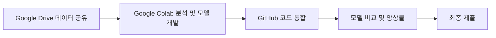
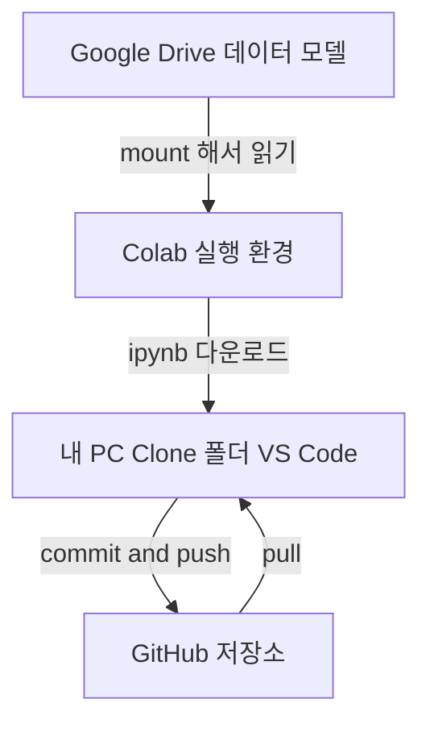
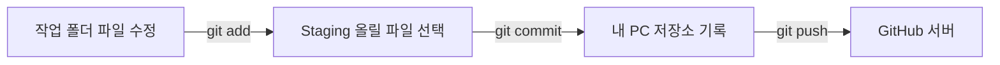
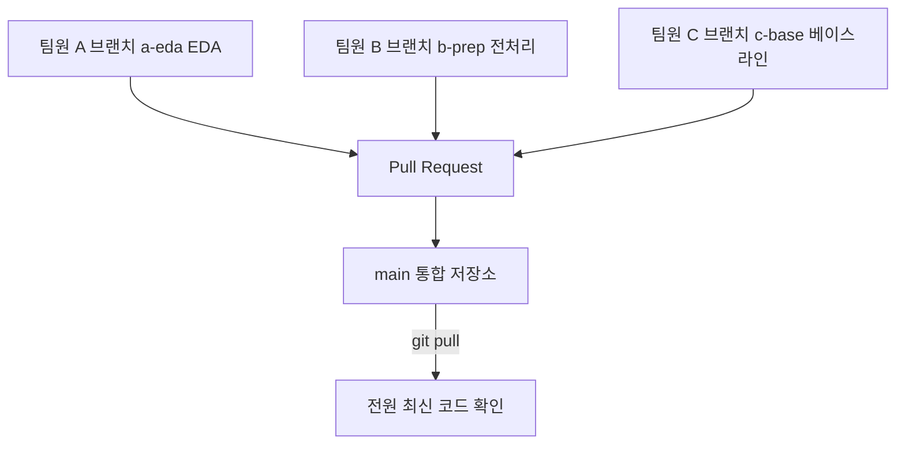
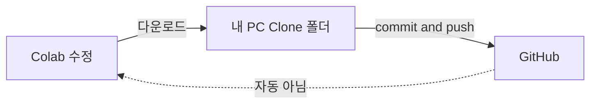
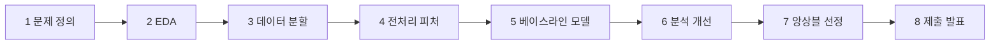
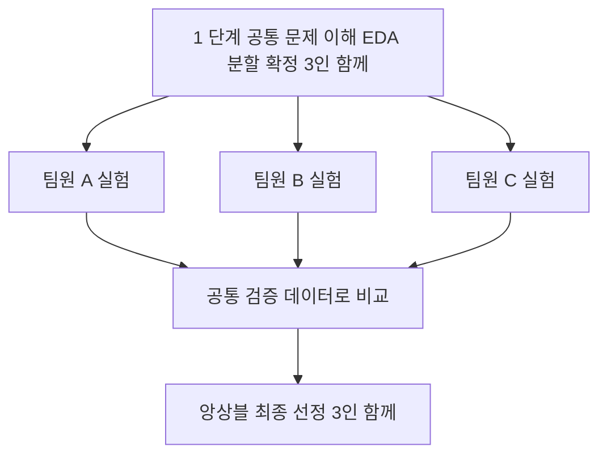

# Chapter 1. 데이터톤이란?

## 1-1. 데이터톤 vs 해커톤

| 구분 | 해커톤 | 데이터톤 (우리 대회) |
|---|---|---|
| 목표 | 새로운 서비스/앱을 만들어 시연 | 주어진 **데이터**로 문제를 풀고 **예측 성능**을 겨룸 |
| 결과물 | 동작하는 프로토타입 | 예측 결과 파일 + 코드 + 분석/발표 |
| 평가 | 아이디어, 완성도, 발표 | **평가 지표 점수**(정량) + 분석 근거 + 발표 |
| 핵심 기술 | 개발(웹/앱 등) | 데이터 분석, 전처리, 머신러닝 |

## 1-2. 데이터톤에서 실제로 하는 일 (용어 사전)

| 용어 | 한 줄 설명 | 예시 |
|---|---|---|
| **EDA** (탐색적 데이터 분석) | 모델을 만들기 전에 데이터를 눈으로 훑어보며 특징·문제를 파악 | 컬럼 개수, 결측치 비율, 정답(label) 비율, 분포 그래프 확인 |
| **전처리** | 모델이 먹을 수 있게 데이터를 정리 | 빈칸(결측치) 채우기, 문자 → 숫자 변환, 이상한 값 제거 |
| **학습(Train) 데이터** | 모델이 공부하는 문제집 | 전체의 약 80% |
| **검증(Validation) 데이터** | 공부한 모델을 시험 보는 모의고사 (정답을 알고 있음) | 전체의 약 20% |
| **테스트(Test) 데이터** | 대회 측이 가진 진짜 시험지 (정답 비공개) | 제출 파일을 만들 대상 |
| **모델 학습** | 데이터에서 규칙을 찾도록 알고리즘을 훈련 | LightGBM, RandomForest 등 |
| **성능 평가** | 검증 데이터로 점수 계산 | Accuracy, F1, ROC-AUC, RMSE 등 (**대회가 정한 지표** 사용) |
| **피처 엔지니어링** | 기존 컬럼으로 더 쓸모 있는 새 컬럼을 만듦 | 생년월일 → 나이, 구매금액 / 구매횟수 → 평균 구매액 |
| **앙상블** | 여러 모델의 예측을 합쳐 더 안정적인 결과를 만듦 | 3명이 만든 모델 예측의 평균 |

> **핵심 요약** 
> 1. 데이터톤의 승부는 "**검증 점수를 얼마나 믿을 수 있게 올리느냐**"이다.
> 2. 학습 데이터로 점수를 재면 항상 높게 나온다. 반드시 **검증 데이터**로 평가한다.
> 3. 시간이 짧으므로 **간단한 모델(베이스라인)을 먼저** 만들고 그 위에 개선한다.

## 1-3. 최종 결과물에는 무엇이 필요한가?

대회 공지의 제출 규정이 **항상 우선**이다. 일반적으로 다음이 필요하다.

| 결과물 | 내용 | 비고 |
|---|---|---|
| 예측 결과 파일 | 대회가 지정한 형식(CSV 등)의 제출 파일 | 컬럼명·행 개수·형식 검증 필수 |
| 재현 가능한 코드 | 처음부터 다시 돌리면 같은 결과가 나오는 Notebook/스크립트 | README에 실행 순서 명시 |
| 학습된 모델 | 모델 파일 (규정에 따라 제출/보관) | GitHub 금지, Drive 공유 |
| 분석 근거 | EDA 인사이트, 피처 설명, 실험 비교표 | 발표의 핵심 |
| 발표 자료 | 문제 이해 → 접근 → 결과 → 인사이트 | 점수만큼 중요한 평가 요소일 수 있음 |

---

# Chapter 2. 우리 팀의 전체 작업 구조

## 2-1. 한눈에 보는 작업 흐름



## 2-2. 세 도구의 역할

| 도구 | 역할 | 올리는 것 | 올리면 안 되는 것 |
|---|---|---|---|
| **GitHub** | 코드 보관, 버전 관리, 통합 | `.ipynb`, `.py`, README, 실험 기록(작은 CSV) | 원본 데이터, 대용량 파일, 모델 가중치, 비밀번호/API 키 |
| **Google Drive** | 대용량 파일 공유 | 원본 데이터, 전처리 데이터, 학습된 모델 | (코드의 최신본 관리는 GitHub에서) |
| **Google Colab** | 코드 실행 환경(클라우드) | - (실행하는 곳) | - |
| **VS Code** | 내 컴퓨터에서 Git 작업·파일 편집 | - | - |



## 2-3. 반드시 기억할 4가지

> **주의**
> 1. **대용량 데이터는 GitHub에 올리지 않는다.** (용량 제한, 대회 데이터 유출 위험)
> 2. 원본 데이터와 모델 가중치는 **대회 규정에 따라** 팀원끼리만 Drive로 공유한다. 외부 공개 링크 금지.
> 3. **Colab에서 코드를 고쳐도 GitHub에는 자동 반영되지 않는다.** 내 PC로 파일을 옮겨 commit & push 해야 한다.
> 4. 팀원마다 **GitHub 저장소를 Clone한 내 PC 폴더**가 따로 있다. (내 폴더 ≠ 팀원 폴더 ≠ GitHub 서버)

## 2-4. 저장소 폴더 구조 (권장안)

> **주의: 실제 구조 확인 불가**
> 이 문서를 만들 때 저장소(`mingyo07/Datathon-2026`)와 로컬 폴더에 접근할 수 없었다(GitHub 주소가 404로 응답 = 비공개이거나 접근 권한 없음). 그래서 **실제 파일 구조를 확인하지 못했고**, 아래는 "이렇게 쓰자"는 **제안**이다. 이미 있는 폴더와 다르면 **실제 구조를 우선**하고, 아래 3-6의 `tree` 명령으로 확인한다.

```text
Datathon-2026/
├─ README.md              # 프로젝트 소개 + 실행 방법
├─ .gitignore             # Git이 무시할 파일 목록 (data/, models/ 등)
├─ notebooks/
│  ├─ A_이름/              # 팀원 A 개인 Notebook 폴더
│  ├─ B_이름/              # 팀원 B
│  └─ C_이름/              # 팀원 C
├─ src/                   # 팀 공통 코드 (데이터 분할, 평가 함수 등)
├─ docs/                  # 문서 (이 가이드, 실험 기록표)
├─ data/                  # (로컬 전용, Git 제외) Drive에서 받은 데이터
└─ models/                # (로컬 전용, Git 제외) 모델 파일
```

> **체크포인트**
> - 세 도구의 역할을 한 문장으로 말할 수 있는가?
> - "Colab 수정 → GitHub 자동 반영"이 **틀린** 이유를 설명할 수 있는가?

---

# Chapter 3. GitHub 처음 사용하기

## 3-1. 기본 개념

| 용어 | 쉬운 설명 | 비유 |
|---|---|---|
| **Git** | 내 컴퓨터에서 파일 변경 이력을 기록하는 프로그램 | 게임의 "세이브 기능" |
| **GitHub** | Git 저장소를 인터넷에 올려 팀이 공유하는 웹 서비스 | 세이브 파일을 모아두는 "클라우드 저장소" |
| **Repository(저장소)** | 프로젝트 폴더 + 변경 이력 전체 | 팀 프로젝트 공유 폴더 |
| **Clone** | GitHub 저장소를 내 PC에 통째로 복사 | 공유 폴더를 내 PC에 내려받기 (처음 1번) |
| **Commit** | 변경 사항을 이름 붙여 "저장 지점"으로 기록 (내 PC에서만) | 세이브 |
| **Push** | 내 PC의 commit을 GitHub로 올리기 | 세이브를 클라우드에 업로드 |
| **Pull** | GitHub의 최신 내용을 내 PC로 가져오기 | 클라우드에서 최신 세이브 내려받기 |
| **Branch** | 독립된 작업 줄기 (main을 건드리지 않고 작업) | 원본 복사본에서 작업하기 |
| **Pull Request (PR)** | "내 브랜치를 main에 합쳐주세요"라는 요청 | 제출 전 검토 요청 |

## 3-2. 회원가입 · Git 설치 · 초대 수락

1. [github.com](https://github.com) → **Sign up**으로 가입 (이메일 인증). 가입한 **사용자명(username)** 을 팀장에게 알려준다.
2. **Git for Windows** 설치: [git-scm.com/download/win](https://git-scm.com/download/win) → 설치 중에는 모두 기본값(Next)으로 진행.
3. **VS Code** 설치: [code.visualstudio.com](https://code.visualstudio.com)
4. **초대 수락**: 팀장이 Collaborator로 초대하면 가입 이메일로 메일이 온다 → 메일의 **View invitation → Accept invitation**. (메일이 없으면 GitHub 우측 상단 프로필 옆 알림 또는 저장소 주소로 접속해 수락 배너 확인)
5. 수락 후 `https://github.com/mingyo07/Datathon-2026` 에 접속되면 성공. (404가 뜨면 아직 초대 수락/로그인이 안 된 것)

## 3-3. 터미널 열기 (VS Code)

VS Code 상단 메뉴 **Terminal → New Terminal** (단축키 `` Ctrl + ` ``). 하단에 PowerShell 창이 열린다. 아래 명령어는 모두 여기서 입력한다.

> **팁** 복사한 명령어는 붙여넣기 후 `Enter`. `<...>` 부분은 **내 정보로 바꿔서** 입력한다 (꺾쇠 괄호도 지운다).

## 3-4. 최초 1회 설정

| 명령어 | 하는 일 | 정상 확인 방법 |
|---|---|---|
| `git --version` | Git 설치 확인 | `git version 2.xx.x...` 가 출력됨 |
| `git config --global user.name "홍길동"` | commit에 표시될 내 이름 설정 | 오류 없이 다음 줄로 넘어감 |
| `git config --global user.email "me@email.com"` | GitHub 가입 이메일 설정 | `git config --global user.email` 입력 시 이메일 출력 |

## 3-5. Clone: 저장소를 내 PC로 복사

```powershell
cd $HOME\Documents
git clone https://github.com/mingyo07/Datathon-2026.git
cd Datathon-2026
```

| 명령어 | 하는 일 | 정상 확인 방법 |
|---|---|---|
| `cd $HOME\Documents` | 문서 폴더로 이동 (원하는 위치 아무 곳이나 가능) | 프롬프트 경로가 `...\Documents`로 바뀜 |
| `git clone https://github.com/mingyo07/Datathon-2026.git` | 저장소 전체를 복사해 `Datathon-2026` 폴더 생성 | `Cloning into 'Datathon-2026'...` 후 `done.`; 처음이면 **브라우저 로그인 창**이 뜨며, 로그인 후 진행됨 |
| `cd Datathon-2026` | 복사된 폴더로 이동 | 프롬프트 끝이 `Datathon-2026>` |

> **주의** OneDrive 동기화 폴더(바탕화면/문서가 OneDrive로 연결된 경우) 안에서 Git 작업을 하면 파일이 꼬일 수 있다. 가능하면 `C:\dev` 같은 일반 폴더를 쓴다: `mkdir C:\dev; cd C:\dev`

## 3-6. 현재 상태 확인 명령어

| 명령어 | 하는 일 | 정상 확인 방법 |
|---|---|---|
| `git status` | 지금 변경된 파일/브랜치 확인 (**가장 자주 쓰는 명령**) | `On branch main` + `nothing to commit, working tree clean` |
| `git log --oneline -5` | 최근 commit 5개 보기 | 한 줄씩 `a1b2c3d 메시지` 형태 |
| `tree /F` 또는 `dir` | 폴더 구조 보기 | 파일/폴더 목록 출력 → **실제 구조를 확인**하자 |
| `git branch` | 브랜치 목록 (`*` = 현재 위치) | `* main` |

## 3-7. Add → Commit → Push 흐름



| 명령어 | 하는 일 | 정상 확인 방법 |
|---|---|---|
| `git add notebooks/A_이름/01_eda.ipynb` | 이번 commit에 포함할 파일 선택(담기) | `git status`에서 파일이 **초록색**(Changes to be committed) |
| `git commit -m "A: EDA 노트북 추가"` | 담은 파일을 내 PC에 기록 | `1 file changed` 출력, `git log --oneline -1`에 메시지 표시 |
| `git push` | commit을 GitHub로 업로드 | `... -> main`(또는 브랜치명) 및 `Writing objects: 100%` ; GitHub 웹에서 파일 확인 |
| `git pull` | GitHub 최신 내용을 내 PC로 가져오기 | `Already up to date.` 또는 `Updating ...` 후 파일 변경 목록 |

> **핵심 요약**
> - **add**=담기, **commit**=내 PC에 기록, **push**=GitHub에 올리기, **pull**=GitHub에서 가져오기
> - commit만 해서는 팀원이 볼 수 없다. **push까지** 해야 공유된다.
> - 좋은 commit 메시지: `A: EDA 노트북 추가`, `B: 결측치 처리 코드 추가` (누가 + 무엇을)
> - `git add .`(전부 담기)는 데이터·모델이 섞일 수 있으니 **파일명을 지정**하거나 `git status`로 확인 후 사용.

## 3-8. Branch와 Pull Request

- **Branch**: `main`은 팀의 "완성본" 줄기다. 각자 자기 **브랜치**에서 작업하면 서로의 작업이 섞이지 않는다.
- **Pull Request(PR)**: 내 브랜치 내용을 main에 합쳐 달라는 요청. 팀원이 내용을 보고 승인(Merge)하면 main에 반영된다.

```text
main     ●────────●────────●────────●   (팀 공통, 안전)
          \        ↑        ↑        ↑
 A-eda     ●──●──●─┘ (PR)
 B-prep       ●──●─────┘ (PR)
 C-base          ●──●───────┘ (PR)
```

| 명령어 | 하는 일 | 정상 확인 방법 |
|---|---|---|
| `git switch -c a-eda` | `a-eda` 브랜치를 새로 만들고 이동 | `Switched to a new branch 'a-eda'` |
| `git switch main` | main으로 이동 | `Switched to branch 'main'` |
| `git push -u origin a-eda` | 새 브랜치를 GitHub에 최초 업로드 | `Branch 'a-eda' set up to track...` + PR 생성 링크 출력 |

## 3-9. GitHub 웹사이트에서 확인하기

GitHub 화면은 업데이트로 바뀔 수 있어 스크린샷 대신 **위치 설명**으로 안내한다.

| 보고 싶은 것 | 방법 |
|---|---|
| 파일/폴더 | 저장소 첫 화면 파일 목록에서 폴더 클릭 |
| 브랜치 전환 | 파일 목록 위 왼쪽의 브랜치 이름 버튼(`main`) 클릭 |
| 최근 commit 이력 | 파일 목록 위 오른쪽의 commit 개수(시계 아이콘) 클릭 |
| 파일 변경 내용 | commit 클릭 → 빨강(삭제)/초록(추가) 비교 화면 |
| Pull Request | 상단 탭 **Pull requests** (새 PR은 **New pull request** 버튼) |
| `.ipynb` 미리보기 | 파일 클릭 시 GitHub이 Notebook 형태로 보여줌 |

> **체크포인트 (실습)**
> - [ ] `git --version` 이 출력된다.
> - [ ] Clone 후 `git status`가 `On branch main` 이다.
> - [ ] GitHub 웹에서 저장소 파일을 열어봤다.

---

# Chapter 4. 개인별 작업 및 GitHub 협업

## 4-1. 우리 팀의 단순 규칙 4가지

1. **내 폴더에서만 작업한다.** `notebooks/<내 폴더>/` 밖의 파일은 함부로 수정하지 않는다.
2. **main에 직접 push 하지 않는다.** 내 브랜치 → Pull Request → 팀원 확인 후 Merge.
3. **작업 시작 전에는 항상 `git pull`.**
4. **같은 Notebook 파일을 두 명이 동시에 수정하지 않는다.**

## 4-2. 왜 개인 Notebook 폴더인가?

- `.ipynb`는 코드뿐 아니라 **실행 결과, 그래프(이미지), 실행 번호**가 한 파일 안에 들어 있다. 사소한 실행만 해도 파일 내용이 크게 바뀐다.
- 두 명이 같은 `.ipynb`를 고치면 Git이 **자동 병합하지 못해** 충돌이 나고, 충돌 난 `.ipynb`는 사람이 읽기도 어렵다.
- 그래서 **파일 이름과 폴더를 분리**하면 충돌 가능성이 거의 0이 된다.

| 구분 | 개인 실험 코드 | 공통 코드 |
|---|---|---|
| 위치 | `notebooks/<내 폴더>/` | `src/`, 공통 설정 |
| 수정 권한 | 본인만 | 팀 합의 후, 한 번에 한 명 |
| 예 | 내 EDA, 내 모델 실험 | 데이터 분할 함수, 평가 함수, 제출 파일 생성 함수 |
| 반영 방식 | PR 후 Merge | PR + 팀원 1명 이상 확인 |

## 4-3. 실습 시나리오: A(EDA) · B(전처리) · C(베이스라인)



### Step 1. 시작 전 최신화 (모두)
```powershell
cd C:\dev\Datathon-2026
git switch main
git pull
```
정상: `Already up to date.` 또는 업데이트 목록.

### Step 2. 내 브랜치 만들기
```powershell
git switch -c a-eda      # A는 a-eda, B는 b-prep, C는 c-base
```
정상: `Switched to a new branch 'a-eda'`.

### Step 3. 내 폴더에 Notebook 저장
Colab에서 받은 `.ipynb`(Chapter 5)를 `notebooks/A_이름/` 폴더에 넣는다. (폴더가 없으면 새로 만든다. 빈 폴더는 Git이 인식하지 않으므로 파일이 있어야 한다.)
```powershell
git status
```
정상: 새 파일이 **빨간색 Untracked files**로 보임.

### Step 4. Commit & Push
```powershell
git add notebooks/A_이름/01_eda.ipynb
git commit -m "A: EDA 노트북 추가"
git push -u origin a-eda
```
정상: push 마지막 줄에 `a-eda -> a-eda`, 그리고 `Create a pull request` 링크 출력.

### Step 5. Pull Request 만들기 (GitHub 웹)
1. 저장소 접속 → 노란 배너 **Compare & pull request** 클릭 (없으면 **Pull requests → New pull request**)
2. base: `main` ← compare: `a-eda` 확인
3. 제목/설명에 무엇을 했는지 한두 줄 작성 → **Create pull request**
4. **다른 팀원 1명이 확인** 후 **Merge pull request → Confirm merge**

### Step 6. 팀원의 코드 가져오기 (모두)
```powershell
git switch main
git pull
```
정상: 팀원의 파일 목록이 `Updating ...` 아래에 나타나고, VS Code 탐색기에서 폴더가 생김. 이제 B, C의 Notebook을 열어 확인할 수 있다.

### Step 7. 내 브랜치도 최신 main 반영 (작업을 이어갈 때)
```powershell
git switch a-eda
git merge main
```
정상: `Already up to date.` 또는 `Merge made by...`.

> **팁** 다음 작업을 시작할 때는 가장 안전하게: **main으로 가서 pull → 새 브랜치(`a-eda-2`) 만들어 작업**.

## 4-4. Git 충돌은 왜 생기고 어떻게 피하는가

**원인**: 두 사람이 **같은 파일의 같은 부분**을 서로 다르게 고친 상태에서 합치려 하면, Git은 어느 쪽이 맞는지 알 수 없어 멈춘다.

**피하는 방법**
- 개인 폴더 사용 (4-2), 같은 파일 동시 수정 금지
- 작업 시작 전 `git pull`, 자주 commit/push (작은 단위로)
- 공통 파일을 고쳐야 하면 팀 채팅에 "`src/split.py` 수정합니다"라고 **먼저 알리기**
- `.ipynb` 제출 전에 불필요한 실행 결과 줄이기 (`Edit → Clear all outputs` 후 다운로드, 단 결과 그래프가 필요하면 유지)

**충돌이 났을 때** (Chapter 8-4 참고): 충돌 파일이 VS Code에 표시되고 `<<<<<<<` `=======` `>>>>>>>` 표시가 나온다. 혼자 해결하려 하지 말고 **팀원과 같이** 어느 쪽을 쓸지 정한다.

> **체크포인트 (실습)**
> - [ ] 내 브랜치를 만들고 push 했다.
> - [ ] GitHub 웹에서 PR을 만들고 Merge까지 해봤다.
> - [ ] main에서 `git pull`로 B, C의 파일을 받았다.

---

# Chapter 5. Google Drive와 Google Colab 사용법

## 5-1. 전체 단계

| 단계 | 할 일 | 도구 |
|---|---|---|
| 1 | 팀 공용 Drive 폴더 접속 + **내 드라이브에 바로가기 추가** | Drive |
| 2 | 새 Colab Notebook 생성 | Colab |
| 3 | Drive 연결(mount) | Colab |
| 4 | CSV/Parquet 불러오기 | Colab |
| 5 | 분석 및 모델 학습 | Colab |
| 6 | 결과/모델 Drive에 저장 | Colab |
| 7 | `.ipynb` 다운로드 | Colab → 내 PC |
| 8 | 저장소 폴더에 복사 → commit & push | VS Code |

## 5-2. 팀 공용 Drive 폴더 접속

1. 팀장이 보낸 Drive 폴더 링크를 열고 같은 Google 계정(Colab에서 쓸 계정)으로 로그인한다.
2. 폴더 이름 옆 ▼ → **정리(Organize) → 바로가기 추가(Add shortcut)** → **내 드라이브** 선택.
3. 이렇게 하면 Colab에서 `내 드라이브/폴더명`으로 쉽게 접근된다. (바로가기 없이는 "공유 문서함" 경로가 달라 헷갈린다)

> **주의: 경로는 사람마다 다를 수 있다**
> 바로가기를 어디에 만들었는지, 폴더 이름을 바꿨는지에 따라 `/content/drive/MyDrive/...` 아래 경로가 달라진다. 코드에 경로를 **한 줄 변수**(`DATA_DIR`)로 두고 **각자 자기 경로로 수정**한다. 남의 경로를 그대로 복사하면 `FileNotFoundError`가 난다.

## 5-3. Colab Notebook 만들기

1. [colab.research.google.com](https://colab.research.google.com) 접속 → **새 노트북**
2. 파일명을 `01_eda_이름.ipynb` 처럼 **규칙에 맞게** 변경 (상단 제목 클릭)
3. 필요 시 **런타임 → 런타임 유형 변경 → GPU** (딥러닝 모델일 때만; 표 형태 데이터는 보통 CPU로 충분)

## 5-4. Drive 연결 + 데이터 불러오기

셀에 입력하고 `Shift + Enter`로 실행한다.

```python
from google.colab import drive
drive.mount('/content/drive')
```
정상: 권한 허용 창 → 허용 → `Mounted at /content/drive`.

```python
import os
DATA_DIR = '/content/drive/MyDrive/Datathon-2026/data'   # ← 내 경로로 수정!
print(os.listdir(DATA_DIR))
```
정상: 데이터 파일 이름 목록이 출력. `FileNotFoundError`면 왼쪽 **폴더 아이콘**에서 `drive → MyDrive`를 열어 실제 경로를 확인한다.

```python
import pandas as pd
train = pd.read_csv(f'{DATA_DIR}/train.csv')            # CSV
# train = pd.read_parquet(f'{DATA_DIR}/train.parquet')  # Parquet
print(train.shape)
train.head()
```
정상: `(행 개수, 열 개수)` 출력 및 표 5줄 표시. (`train.csv` 등 파일명은 **예시**이며 실제 대회 파일명으로 바꾼다.)

## 5-5. 분석 · 학습 · 저장

```python
train.info()                 # 컬럼, 타입, 결측치
train.describe()             # 숫자 컬럼 통계
train.isna().mean()          # 결측치 비율
```

```python
# 결과/모델은 Drive에 저장해야 세션이 끊겨도 남는다
import joblib
SAVE_DIR = '/content/drive/MyDrive/Datathon-2026/models'  # ← 내 경로로 수정!
os.makedirs(SAVE_DIR, exist_ok=True)
joblib.dump(model, f'{SAVE_DIR}/a_baseline_v1.joblib')
```
정상: Drive 웹의 해당 폴더에 파일이 생김. **파일명에 이름/버전**(`a_baseline_v1`)을 넣어 덮어쓰기를 막는다.

> **주의** Colab의 `/content/` 아래(왼쪽 파일 창의 `sample_data` 등)에 저장한 파일은 **세션이 끝나면 사라진다.** 중요한 것은 반드시 **Drive**에 저장.

## 5-6. Notebook 다운로드 → GitHub 반영

1. Colab 메뉴 **파일 → 다운로드 → .ipynb 다운로드** (다운로드 폴더에 저장됨)
2. 파일을 내 PC의 `Datathon-2026\notebooks\<내 폴더>\` 로 **이동/복사**
3. VS Code 터미널에서 Chapter 4의 Step 4 (add → commit → push) 수행

> **주의: 자동 동기화가 아니다**
> Colab ↔ 내 PC 폴더 ↔ GitHub는 **서로 연결되어 있지 않다.** Colab에서 코드를 고치면 **고친 만큼 다시 다운로드 → 복사 → commit → push** 해야 팀원이 본다. (Colab의 `파일 → GitHub에 사본 저장`도 있지만, 브랜치/폴더 관리가 어려워 이 가이드에서는 쓰지 않는다.)



> **체크포인트 (실습)**
> - [ ] Drive 바로가기를 만들고 `Mounted at /content/drive`를 봤다.
> - [ ] 데이터를 불러와 `shape`를 출력했다.
> - [ ] `.ipynb`를 내 폴더에 넣고 push까지 했다.

---

# Chapter 6. 데이터톤 실전 진행 순서

무박 2일에서는 **"초기 베이스라인을 빠르게 확보"** 하는 것이 가장 중요하다. 베이스라인이 있어야 (1) 제출 파일이 최소 1개 확보되고, (2) 이후 개선이 실제로 좋아졌는지 비교할 기준이 생긴다.



| 단계 | 무엇을 하나 | 왜 필요한가 | 나와야 할 결과물 | 팀에 공유할 것 |
|---|---|---|---|---|
| **1. 문제 정의·평가 기준** | 대회 공지 정독: 무엇을 예측? 평가 지표? 제출 형식? 금지 규정? | 잘못 이해하면 전체가 헛수고 | 1페이지 요약(목표, 지표, 제출 형식, 마감) | 요약 문서 (`docs/`) |
| **2. EDA** | 컬럼 의미, 결측치, 정답 비율, 분포, 이상값 확인 | 어떤 전처리·모델이 필요한지 판단 근거 | 핵심 발견 5~10줄 + 그래프 | EDA Notebook, 발견 사항 |
| **3. 데이터 분할** | train/validation 나누기 (필요 시 시간순/그룹 고려), **한 번 정해 모두가 같은 분할 사용** | 같은 시험지로 점수를 재야 모델 비교가 공정함 | 분할 코드 + 고정 seed(예: 42) + 분할 결과 파일/인덱스 | `src/` 분할 함수, seed 값 |
| **4. 전처리·피처 엔지니어링** | 결측치/범주형 처리, 새 피처 생성 | 모델 성능의 큰 부분이 여기서 결정 | 전처리 함수, 피처 목록 | 전처리 코드, 만든 피처 설명 |
| **5. 베이스라인·모델 개발** | 간단한 모델(예: LightGBM 기본값)로 점수 1개 확보 → 이후 모델 확장 | 기준점 + 제출 파일 보험 | 검증 점수, 첫 제출 파일 | 점수, 모델 파일(Drive), 실험 기록표 |
| **6. 결과 분석·개선** | 틀린 예측 분석, 피처 중요도, 하이퍼파라미터 조정 | 무작정 시도보다 근거 있는 개선이 효율적 | 개선 전/후 점수 비교 | 무엇을 바꿨고 점수가 어떻게 변했는지 |
| **7. 앙상블·최종 모델** | 여러 모델 예측을 평균/가중 평균 → 최고 조합 선택 | 단일 모델보다 안정적 | 최종 모델 조합, 최종 검증 점수 | 각 모델의 **검증 예측값** 파일(Drive) |
| **8. 제출·발표** | 제출 파일 검증, 코드 정리, README, 발표 | 점수가 높아도 제출 오류면 0점 | 제출 파일, 정리된 코드, 발표 자료 | 최종 파일 위치, 발표 분담 |

> **무박 2일 시간 배분 예시 (참고용, 대회 일정에 맞게 조정)**
>
> | 시간대 | 목표 |
> |---|---|
> | 시작 ~ 3시간 | 문제 이해 + 공통 EDA + 분할 확정 |
> | ~ 8시간 | **베이스라인 + 첫 제출 파일 확보** |
> | ~ 30시간 | 각자 모델·피처 실험, 점수 비교, 개선 |
> | ~ 40시간 | 앙상블, 최종 모델 선정 |
> | 마지막 6~8시간 | 제출 검증, 코드 정리, 발표 준비 (**새 실험은 중단**) |

> **핵심 요약**
> - 완벽한 모델보다 **돌아가는 베이스라인**이 먼저.
> - **검증 데이터 분할은 한 번 정해서 모두가 같게** 쓴다.
> - 매 단계의 결과물은 **Drive(큰 파일)와 GitHub(코드)** 에 남긴다.

---

# Chapter 7. 3인 팀 역할 분담

## 7-1. 기본 방식: 공통 → 병렬 실험 → 공통 비교

역할(EDA/전처리/모델)을 **고정하지 않는다.** 초반에 같이 데이터를 이해하고, 이후 각자 다른 시도를 병렬로 하며 **같은 검증 데이터**로 비교한다.



## 7-2. 역할 분담표 (예시, 상황에 따라 교체)

| 시간대 | 팀원 A | 팀원 B | 팀원 C |
|---|---|---|---|
| 초반 (공통) | EDA: 컬럼·분포 | EDA: 결측·이상값 | 평가 지표·제출 형식 정리, 분할 코드 초안 |
| 베이스라인 | 트리 모델 (LightGBM) | 전처리 개선 + 같은 모델 | 단순 모델 (로지스틱 등) |
| 중반 실험 | 피처 엔지니어링 세트 1 | 피처 엔지니어링 세트 2 / 다른 모델 | 하이퍼파라미터 튜닝 / 다른 모델 |
| 후반 | 앙상블 코드 | 제출 파일 검증, 코드 정리 | 발표 자료, README |
| 공통 책임 | 하루 2~3회 점수/기록 공유, 개인 브랜치 push | | |

> 위 표는 **제안일 뿐이다.** 각자 잘하는 영역, 막힌 부분에 따라 서로 바꾼다. 단, "**지금 누가 무엇을 하는지**"는 항상 팀 채팅에 공유한다.

## 7-3. 모델 실험 기록표 (예시)

`docs/experiments.md` 같은 **한 파일**을 두고 각자 **자기 행만** 추가한다. (같은 줄을 동시에 고치지 않도록, 충돌이 나면 PR에서 함께 해결하거나 팀 채팅 공유 표/구글 시트를 쓴다.)

| 번호 | 담당 | 날짜·시간 | 모델 | 사용 피처/전처리 | 분할(seed) | 검증 점수 | 모델 파일 위치 | 메모 |
|---|---|---|---|---|---|---|---|---|
| E01 | A | 11/14 14:00 | LightGBM 기본값 | 원본 컬럼만 | 42 | (기록) | Drive/models/a_base_v1 | 베이스라인 |
| E02 | B | 11/14 15:30 | LightGBM | + 결측 처리 | 42 | (기록) | Drive/models/b_prep_v1 | |
| E03 | C | 11/14 16:00 | 로지스틱 | 스케일링 | 42 | (기록) | Drive/models/c_log_v1 | 비교용 |

> **체크포인트**
> - 모든 실험은 **같은 분할(seed), 같은 평가 지표**로 기록한다.
> - 점수만 적지 말고 "무엇을 바꿨는지"를 적어야 발표 근거가 된다.
> - 제출용 최종 모델은 **검증 점수 + 안정성**으로 팀이 함께 결정한다.

---

# Chapter 8. 실전 체크리스트와 문제 해결

## 8-1. 체크리스트

**대회 시작 전**

- [ ] GitHub 초대 수락
- [ ] Git Clone 완료 (`git status` 정상)
- [ ] Google Drive 접근 확인 (바로가기 추가)
- [ ] Colab 실행 및 Drive mount 확인
- [ ] 개인 작업 폴더 확인

**대회 진행 중**

- [ ] 데이터 분석(EDA) 결과 공유
- [ ] 공통 데이터 분할 확인 (모두 같은 seed/파일)
- [ ] 베이스라인 개발 + 첫 점수 확보
- [ ] 실험 결과 기록 (기록표)
- [ ] 코드 Commit 및 Push (최소 몇 시간마다)
- [ ] 결과 비교

**대회 종료 전**

- [ ] 최종 예측 결과 확인
- [ ] 모델 파일 확보 (Drive)
- [ ] 최종 코드 정리
- [ ] README 실행 방법 확인 (처음부터 따라 해서 실행 가능한지)
- [ ] 제출 파일 검증 (컬럼명, 행 개수, 형식, 결측값)
- [ ] 발표 자료 준비

## 8-2. 문제 해결

| 증상 | 원인 | 해결 방법 |
|---|---|---|
| **`git`을 인식하지 못함** (`'git' is not recognized...`) | Git 미설치, 또는 설치 후 터미널을 다시 안 열었음 | 1) VS Code 완전히 종료 후 재실행 2) 그래도 안 되면 Git for Windows 재설치(기본값) 3) `git --version` 으로 확인 |
| **GitHub 인증 실패** (`Authentication failed`, 로그인 창이 안 뜸) | 로그인 정보 오류 / 초대 미수락 / 비밀번호로 인증 시도 | 1) 브라우저에서 GitHub 로그인 및 **초대 수락 확인** 2) GitHub는 비밀번호 인증을 지원하지 않으므로 **브라우저 로그인 창** 또는 **Personal Access Token**을 사용 3) Windows `자격 증명 관리자 → github.com 항목 삭제` 후 다시 시도 |
| **Push 거부** (`rejected`, `non-fast-forward`, `failed to push`) | GitHub에 내 PC에 없는 새 commit이 있음 / 권한 없음 | 1) `git pull` 후 다시 `git push` 2) 권한 문제(`403`)면 팀장에게 Collaborator 권한 확인 요청 3) 절대 `git push --force` 사용 금지 |
| **Git 충돌** (`CONFLICT`, `Automatic merge failed`) | 같은 파일의 같은 부분을 서로 수정 | 1) 당황하지 말고 `git status`로 충돌 파일 확인 2) 팀원과 함께 어느 내용을 쓸지 결정 3) 파일의 `<<<<<<<`, `=======`, `>>>>>>>` 줄을 정리해 최종 내용만 남김 4) `git add 파일` → `git commit` 5) 도저히 모르겠으면 `git merge --abort` 로 합치기 이전으로 되돌리고 팀원에게 도움 요청 |
| **Colab에서 Drive 경로 못 찾음** (`FileNotFoundError`) | mount 안 함 / 바로가기 없음 / 경로·철자·대소문자 오류 | 1) `drive.mount` 셀 실행 확인 2) 왼쪽 폴더 아이콘 → `drive/MyDrive`로 실제 경로 확인 3) 공유 폴더는 **내 드라이브에 바로가기** 추가 4) `os.listdir('/content/drive/MyDrive')` 로 한 단계씩 확인 |
| **Colab 세션 종료로 파일 사라짐** | `/content/` 아래 임시 저장소는 세션이 끝나면 삭제됨 | 1) 이미 사라진 파일은 복구 불가 → 코드를 다시 실행 2) 앞으로 **모델·결과는 Drive에 저장** 3) Notebook은 수시로 **다운로드(.ipynb)** 4) 오래 걸리는 학습은 중간 저장(checkpoint) 활용 |

## 8-3. 위급 상황 규칙

- **모르겠으면 멈추고 질문**한다. 임의로 `reset --hard`, `push --force`, 폴더 삭제를 하지 않는다.
- 막히면 내 폴더를 **통째로 복사해 백업**한 뒤 시도한다.
- 실수로 큰 파일/비밀 정보를 push 했다면 **즉시 팀장에게 알린다.** (파일 삭제만으로는 이력에 남을 수 있다)

> **마지막 체크포인트** 
> 이 가이드의 3장 → 4장 → 5장 실습을 대회 시작 **전에** 한 번씩 해 본다. 대회 당일의 시간은 Git이 아니라 **데이터와 모델**에 써야 한다.
